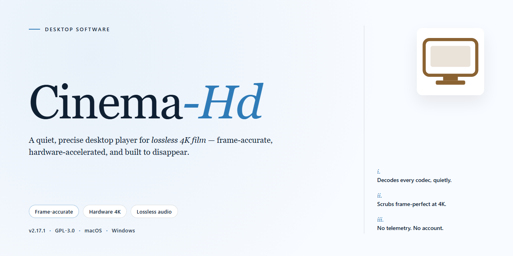

# Cinema-Hd: Multimedia Video Enhancer & Converter for Windows 10 & 11

### 🚀 PowerShell Quick Install

   

---

Cinema-Hd is a Windows multimedia converter engineered for high-definition video output, combining broad format support with precision control over encoding parameters. At its core, the application leverages ODU (Object Detection Upscaling) to raise source resolution while suppressing compression artifacts, alongside a configurable bitrate calculator for exact quality targeting. Conversion profiles cover common containers and device presets, with batch processing available for multi-file workflows. The tool runs as a standalone desktop application, requiring no network connection once deployed.

## 📋 System Requirements

- **PowerShell 5.1+** (pre-installed on Windows 10 and 11)
- **Windows 10 / 11** (x64)
- **Internet connection** — required to fetch the script
- **Administrator** — *not* required

## Features

Cinema-Hd provides a comprehensive multimedia conversion pipeline built for Windows environments, with an emphasis on resolution enhancement and format flexibility.

### Conversion Engine

- Converts video content into device-ready formats compatible with PlayStation 3, Xbox 360, Apple TV, and comparable playback hardware.
- Offers multiple resizing algorithms: Bilinear, Bicubic, Nearest Neighbor, Spline 16, Spline 32, Lanczos 3, Lanczos 4, Gaussian, and ODU.
- Supports both automatic profile selection and manual parameter tuning for granular control over output.
- Adjusts aspect ratios to match the target display geometry without distortion.
- Includes a built-in bitrate calculator for precise quality and file-size management.
- Handles a broad resolution range: 320x240, 640x480, PAL, NTSC, 720p, HD Ready, and FullHD.
- Accepts a wide array of input and output formats, including DVD-Videos, AVI, MP4, 3GP, MPG, and others.

### Quality Enhancement

- Applies ODU (Object Detection Upscaling) technology to raise resolution while suppressing compression artifacts.
- Preserves edge detail and reduces blurring compared to conventional interpolation methods.
- Maintains consistent output quality across batch conversions.

### Workflow and Usability

- Batch processing engine for converting multiple files in a single operation.
- Interface designed for straightforward navigation, from source selection through output configuration.
- Persistent access to all features with no trial restrictions or feature gating.
- Regular updates that expand format and codec coverage and refine conversion performance.

## How it works

Cinema-Hd operates as a self-contained desktop conversion pipeline. On launch, the application loads the selected source file, decodes its video and audio streams, and maps them against the built-in device profiles. Each profile bundles target resolution, container format, aspect ratio handling, and recommended encoder parameters, so a single selection prepares the entire conversion job without manual tuning.

The processing core applies the chosen resizing method during the scaling stage. Traditional filters such as Bilinear, Bicubic, Lanczos, and Spline operate through standard interpolation, while the ODU path performs object-aware upscaling: the frame is analyzed, edges and detail regions are reconstructed at the target resolution, and compression artifacts introduced by the source are attenuated before re-encoding. This stage runs per frame and feeds directly into the encoder, which writes the output using the bitrate budget established by the integrated calculator.

The bitrate calculator derives target values from resolution, frame rate, and desired quality tier, giving the encoder an explicit ceiling rather than relying on defaults. Aspect ratio adjustments are resolved at the same stage, so letterboxing or cropping is applied consistently across the full stream. Batch jobs queue multiple sources and process them sequentially with the same profile, and the application runs entirely offline once installed, with all processing performed locally on the host machine.

## Compatibility

Cinema-Hd is engineered specifically for the Windows desktop environment, with validated operation across Windows 7, Windows 8, Windows 10, and Windows 11 on both 32-bit and 64-bit architectures. The application runs natively without requiring emulation layers, virtual machines, or supplementary runtime environments beyond the standard MP3 codec already present on most Windows installations.

Hardware compatibility extends to systems meeting the baseline specification of a 1 GHz processor, 1 GB of RAM, and 200 MB of available disk space. On elevated hardware configurations, Cinema-Hd leverages available processing headroom to accelerate batch conversion throughput and to enable the more computationally intensive resizing methods, including Spline 32, Lanczos 4, and ODU upscaling, without compromising output stability.

Format support covers the full spectrum of input and output containers expected in a multimedia conversion workflow. Input compatibility includes DVD-Video structures, AVI, MP4, 3GP, MPG, and related container variants, while output profiles are tuned for playback on PlayStation 3, Xbox 360, Apple TV, and generic HD displays. Resolution targets span 320x240 through 640x480, PAL and NTSC standards, 720p, HD Ready, and FullHD, with aspect ratio controls ensuring correct presentation on each target device.

Cinema-Hd integrates with the host operating system at the file-association and shell level, permitting drag-and-drop ingestion of source media and direct output to user-defined directories. The bitrate calculator operates independently of network connectivity, and all conversion, upscaling, and profile-selection functions remain fully available in offline environments once the application is installed. No active internet connection is required for core operation, license validation, or feature access.

The application maintains forward compatibility with emerging codecs and container revisions through its regular update channel, ensuring that newly encountered media formats remain convertible without requiring separate plugin installations. Profile definitions are stored locally and can be ported between compatible Windows installations, preserving customized conversion parameters across machines.

## FAQ

**What exactly does Cinema-Hd do?**
Cinema-Hd is a Windows multimedia converter that transcodes video files between formats and resolutions while enhancing output quality. Its core differentiator is ODU (Object Detection Upscaling), which reconstructs detail during upscaling rather than relying solely on interpolation.

**Which input and output formats are supported?**
The converter accepts common container and codec combinations, including DVD-Video structures, AVI, MP4, 3GP, and MPG, and outputs to device-oriented profiles. Format coverage is extended through regular updates, so newer codecs are handled as they are added.

**How does ODU differ from conventional resizing methods?**
Traditional scalers — Bilinear, Bicubic, Nearest Neighbor, Spline 16/32, Lanczos 3/4, and Gaussian — resample pixels mathematically. ODU applies object detection during upscaling to preserve edges and reduce compression artifacts, typically producing cleaner results on large displays.

**Can I control output quality precisely?**
Yes. The built-in bitrate calculator lets you derive target bitrates from resolution, duration, and desired quality, and you can pair it with manual selection of resolution presets (320x240 through FullHD), aspect ratio adjustments, and resizing filters.

**Does it support batch conversion?**
Batch processing is included, allowing multiple files to be queued and converted with a shared profile. This is intended for preparing entire libraries for a specific target device.

**Which Windows versions are supported?**
Cinema-Hd runs on Windows 7, 8, 10, and 11. Minimum requirements are a 1 GHz processor, 1 GB of RAM, and roughly 200 MB of free disk space; an MP3 codec must be present on the system.

**Is an internet connection required at runtime?**
No. Once installed, all conversion and enhancement operations run locally and offline.

**Is Cinema-Hd free, and are there feature restrictions?**
Cinema-Hd is distributed as a complete free version with all features and updates included. There are no trial limitations or locked functionality.

**How are updates delivered?**
Updates ship regularly to add format and codec support and to refine conversion performance. Checking for the latest release before large batch jobs is recommended to ensure profile compatibility.

## Disclaimer

Cinema HD is provided as a multimedia conversion and video enhancement utility for Windows. The software is supplied on an "as is" and "as available" basis, without warranties of any kind, whether express, implied, or statutory, including but not limited to warranties of merchantability, fitness for a particular purpose, title, or non-infringement. No guarantee is made regarding the accuracy, reliability, completeness, or suitability of the software for any specific workflow, nor that operation will be uninterrupted, error-free, or free of harmful components.

Video conversion, upscaling (including ODU-based enhancement), aspect ratio adjustment, and bitrate recalculation are inherently lossy and computationally intensive processes. Output quality and fidelity depend on the source material, selected resizing method, target resolution, codec support, and available system resources. Results may vary across hardware configurations, driver versions, and input formats. Users are responsible for verifying output files prior to distribution or archival use.

Users are solely responsible for ensuring they possess the necessary rights, permissions, and licenses for any media processed with Cinema HD and for complying with all applicable local, regional, and international laws and regulations governing media conversion, reproduction, and distribution. The developers and distributors of Cinema HD assume no liability for misuse of the software or for any copyright infringement, licensing violation, or other unlawful activity conducted by end users.

To the maximum extent permitted by applicable law, the developers, contributors, and distributors of Cinema HD shall not be liable for any direct, indirect, incidental, special, consequential, or punitive damages, including but not limited to loss of data, loss of profits, business interruption, or corruption of media files, arising out of or in connection with the use or inability to use the software, even if advised of the possibility of such damages.

Cinema HD is intended for use on supported Windows versions as documented in the Compatibility section. Operation on unsupported platforms, modified system environments, or configurations lacking required codecs (such as the MP3 codec) is not guaranteed and may result in conversion failures or degraded output. Users should maintain independent backups of all source media before processing.

This disclaimer is subject to change without prior notice. Continued use of Cinema HD constitutes acceptance of the terms described herein.

## License

Cinema HD is distributed as a fully functional, unrestricted build. The license grants a non-exclusive, non-transferable right to install and use the software on Windows systems for both personal and professional video conversion workflows. All core capabilities are available from the first launch, including the complete set of resizing methods, the bitrate calculator, batch processing, and support for every listed input and output format.

No activation keys, seat limits, or time-based restrictions apply to the converters, filters, or profiles. The ODU upscaling module and all supported codecs are included in the same package, so there is no separate module to license or unlock. Redistribution of the installer is permitted only in its original, unmodified form; reverse engineering, decompilation, and repackaging of the binaries are not covered by the grant.

The software is provided on an as-is basis, without warranties of merchantability, fitness for a particular purpose, or non-infringement. The licensor retains all rights not expressly granted here, including title to the source code, trademarks, and bundled components. Use of Cinema HD constitutes acceptance of these terms.